# Portfolio HRMS

A full-stack human resource management system for groups that run more than one company or
site. One person can hold assignments in several organizations at once, each with its own
manager, schedule, time zone, pay and currency. The system covers recruitment, onboarding,
the employee lifecycle, scheduling, time and attendance, leave, compensation, payroll
preparation (gross pay), benefits, performance, documents, notifications and reporting.

It is a portfolio project: a working codebase with a fictional local demonstration, built to
show how the difficult parts of HR software can be handled (organization boundaries, scoped
authorization, separation of duties, time zones, auditable payroll inputs). It is not a
commercial product and has not been certified for production use; see
[Known limitations and deployment prerequisites](#known-limitations-and-deployment-prerequisites).

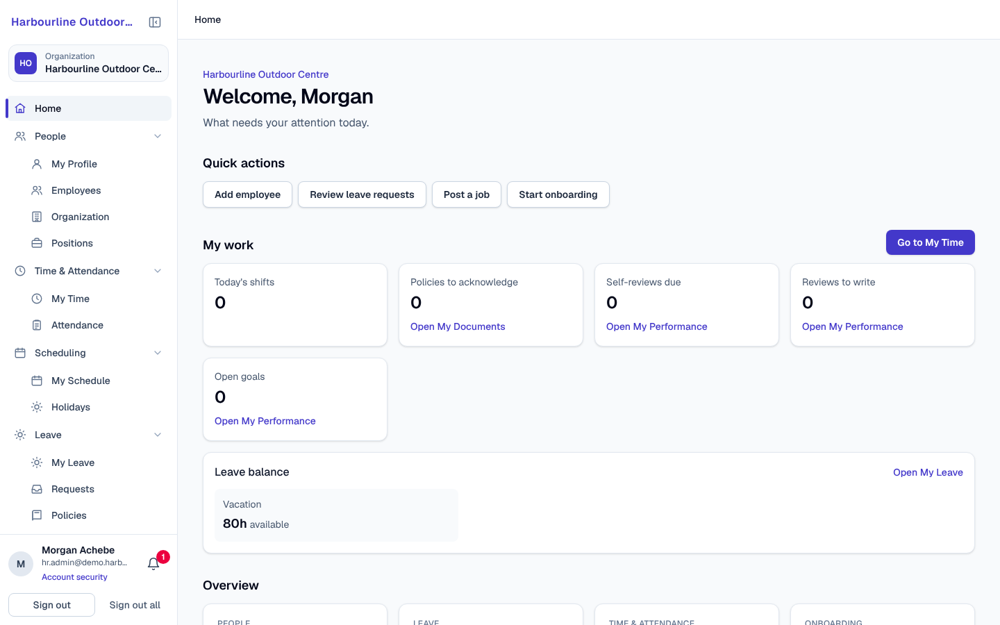

## Contents

- [Core capabilities](#core-capabilities)
- [Screenshots](#screenshots)
- [Architecture overview](#architecture-overview)
- [Technology stack](#technology-stack)
- [Repository structure](#repository-structure)
- [Local installation and quick start](#local-installation-and-quick-start)
- [Fictional demonstration environment](#fictional-demonstration-environment)
- [Automated testing](#automated-testing)
- [Security architecture](#security-architecture)
- [Known limitations and deployment prerequisites](#known-limitations-and-deployment-prerequisites)
- [Documentation](#documentation)
- [License](#license)

## Core capabilities

| Area                          | What it does                                                                                                                                           | Engineering notes                                                                                                                                              |
| ----------------------------- | ------------------------------------------------------------------------------------------------------------------------------------------------------ | -------------------------------------------------------------------------------------------------------------------------------------------------------------- |
| Multi-organization HR         | Organizations, nested organizational units, departments, teams, positions, work locations; employees with one or more employment assignments           | An employee's organization comes from each assignment's position, so one person can work in several organizations                                              |
| Scoped RBAC                   | 74 permissions, role templates, grants scoped to the system, an organization, a unit, a department or a team, with start and expiry dates              | Checked in API services against the target record; a grant on a unit covers its descendants; grants in archived organizations are inactive                     |
| Employee lifecycle            | Hiring, transfers, planned assignments, terminations with per-grant decisions, assignment ends, rehires                                                | Planned assignments activate hourly; due terminations and assignment ends are applied by hand unless lifecycle automation is enabled                           |
| Recruitment and onboarding    | Openings, a candidate pipeline, interviews, offers, hiring into an open position; onboarding and offboarding checklists                                | An accepted offer converts into an employee and assignment, and the onboarding workflow starts from the hire                                                   |
| Attendance and kiosk          | Web clock-in/out, an enrolled onsite kiosk with PINs, presence sign-ins, exceptions, corrections, timesheets with per-assignment approval              | Approval stores a snapshot for payroll; attendance recorded after approval raises an exception instead of silently changing approved time                      |
| Multi-assignment attendance   | One clock-in can cover several assignments of the same person                                                                                          | One physical interval has one payroll owner; coverage rows add no minutes, so the interval is paid exactly once                                                |
| Scheduling                    | Draft and published schedules, templates, recurring patterns, conflict checks, scheduled-hours and scheduled-vs-actual reports                         | Shifts are stored as instants with an IANA time zone; work dates, overnight shifts and daylight-saving changes are computed in that zone                       |
| Leave                         | Leave types and policies, a balance ledger, requests and approvals, holiday and closure markers                                                        | Balances are an append-only ledger with idempotency keys; holiday markers are informational                                                                    |
| Compensation and payroll prep | Effective-dated pay, pay groups and calendars, payroll runs (calculate, approve, finalize), adjustments, payslips, a payroll register                  | Gross pay only: no statutory deductions or net pay. Runs snapshot their inputs; finalized runs are never rewritten; nobody approves their own pay              |
| Benefits and performance      | Benefit plans, coverage options, rates, eligibility, elections and dependents; review cycles, templates, competencies, goals, self and manager reviews | Elections feed payroll deductions for the sponsoring assignment; external assessment evidence informs reviews but never sets a rating                          |
| Reporting                     | Workforce, time, scheduling, leave, compensation, payroll, benefits, performance, recruitment, workflow and document reports with CSV export           | Reports reuse the same scope checks as the underlying records; small groups can be suppressed                                                                  |
| Background jobs               | Shift generation, leave entitlements, payroll period preparation, reminders, notification publishing and delivery, retention and clean-up              | One BullMQ queue; the worker runs handlers compiled from the API. Attendance and lifecycle automation are off by default                                       |
| Auditing                      | Changes to people, access, time, pay and documents write audit entries, viewable per organization                                                      | Append-only through database triggers (see [Security architecture](#security-architecture) for the limits); profile changes record only changed fields, masked |
| Automated testing             | Unit, database integration, HTTP end-to-end and browser suites                                                                                         | See [Automated testing](#automated-testing)                                                                                                                    |

## Screenshots

All screenshots show the fictional demonstration data described in
[docs/development/demo.md](docs/development/demo.md); every person, organization and email
address is invented. They are captured with `pnpm --filter web screenshots:demo` against a
running local demo.

|                                                                                                                                          |                                                                                                   |
| ---------------------------------------------------------------------------------------------------------------------------------------- | ------------------------------------------------------------------------------------------------- |
| 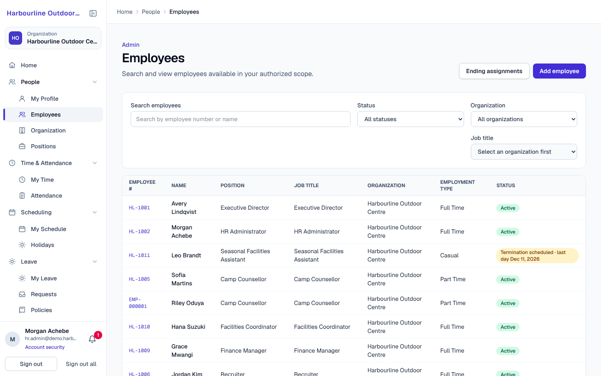 Employee directory                                              | 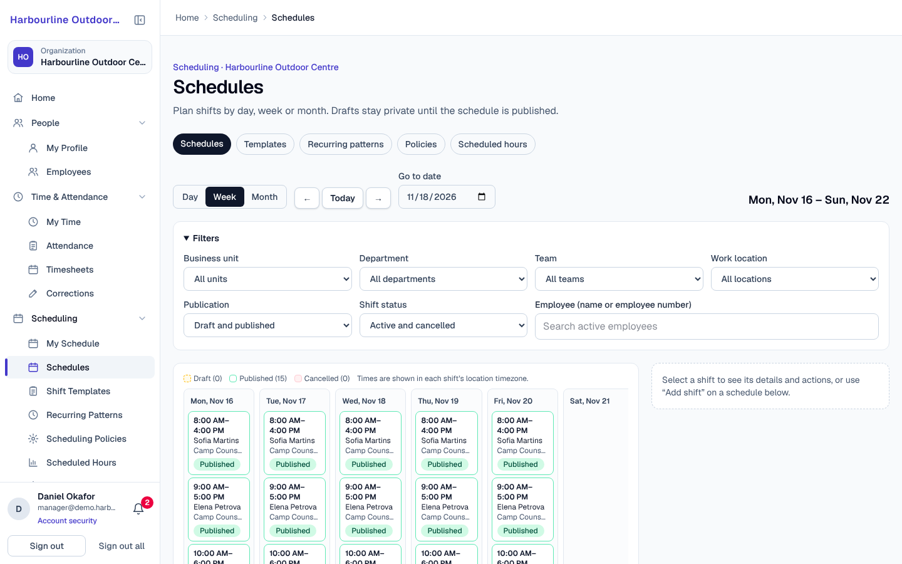 Weekly schedule                     |
| 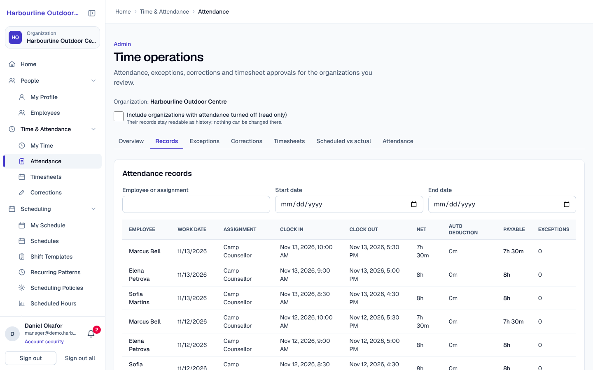 Attendance records                                              | 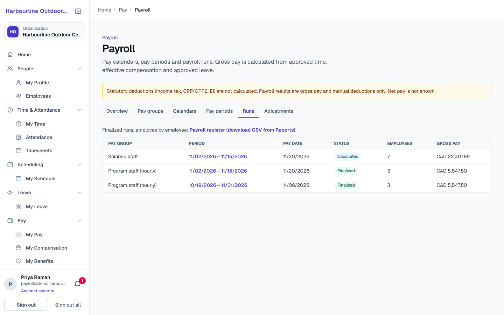 Payroll runs                         |
| 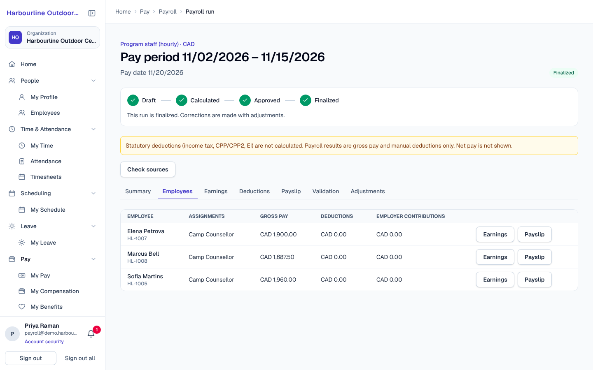 A finalized payroll run                                           | 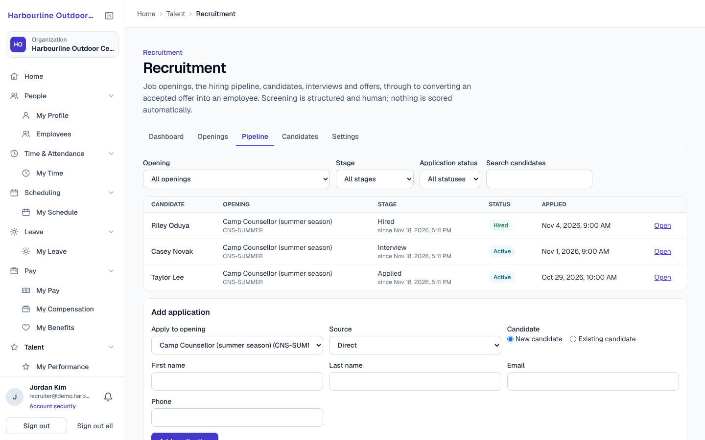 Recruitment pipeline |
| 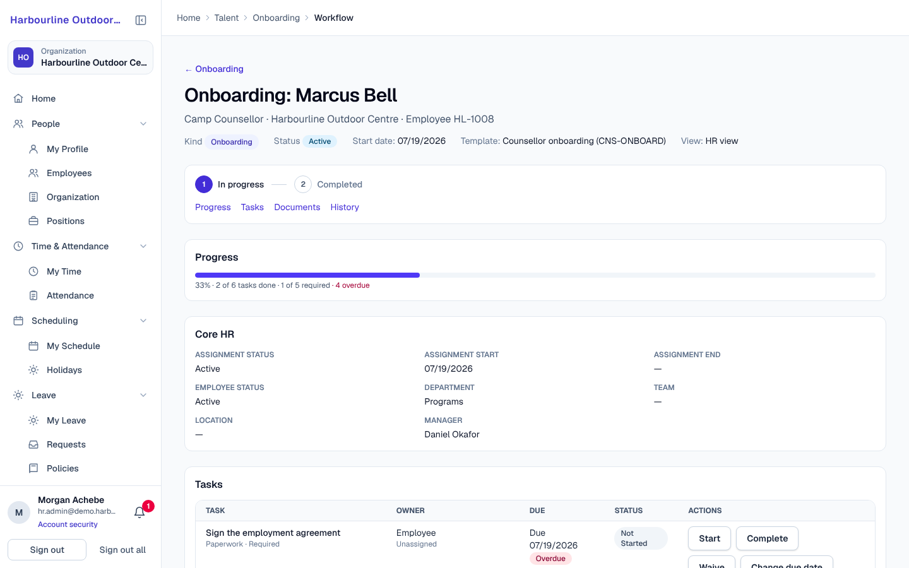 Onboarding workflow                                           | 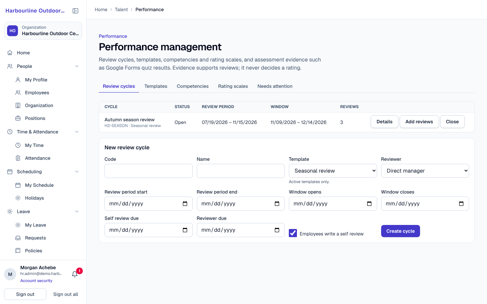 Performance cycles              |
| 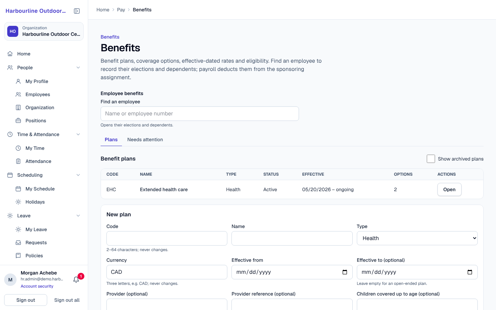 Benefit plans                                                                  | 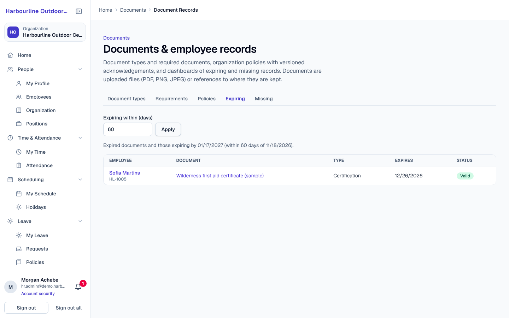 Expiring documents       |
| 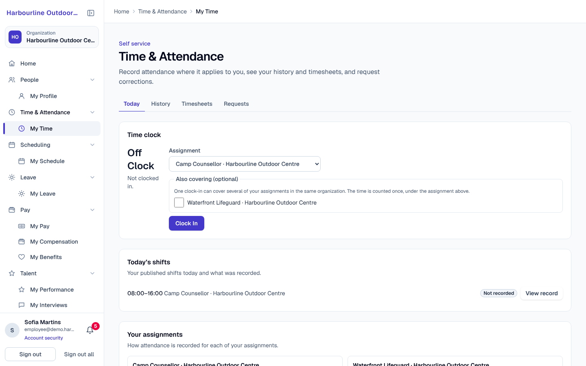 Clock-in with two assignments                             | 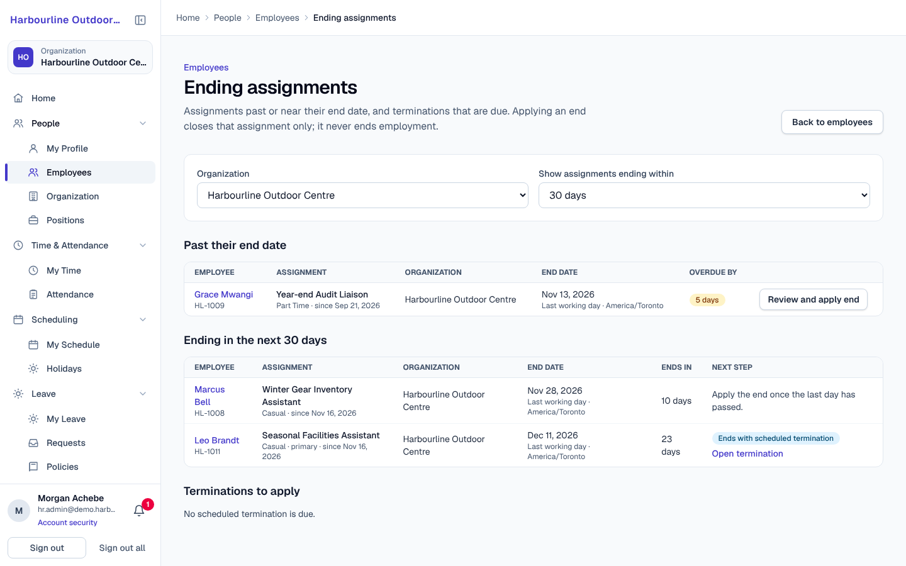 Ending assignments            |
| 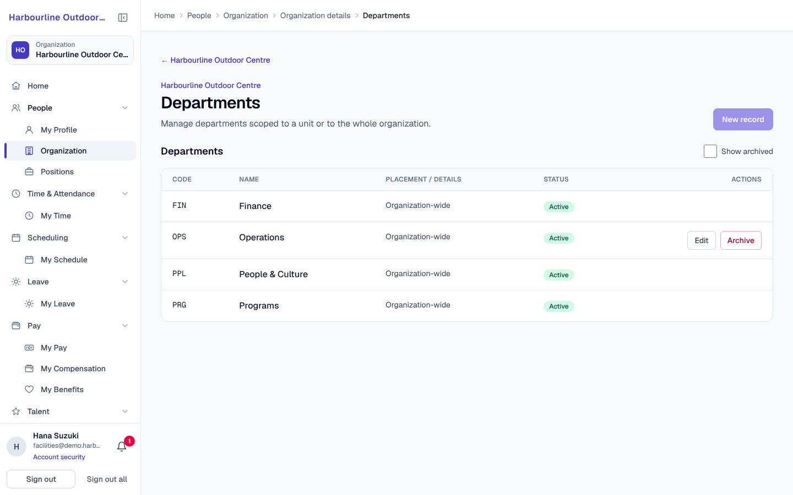 Structure management scoped to one department |                                                                                                   |

A walkthrough of each feature, with the demo account to use, is in
[docs/walkthroughs.md](docs/walkthroughs.md).

## Architecture overview

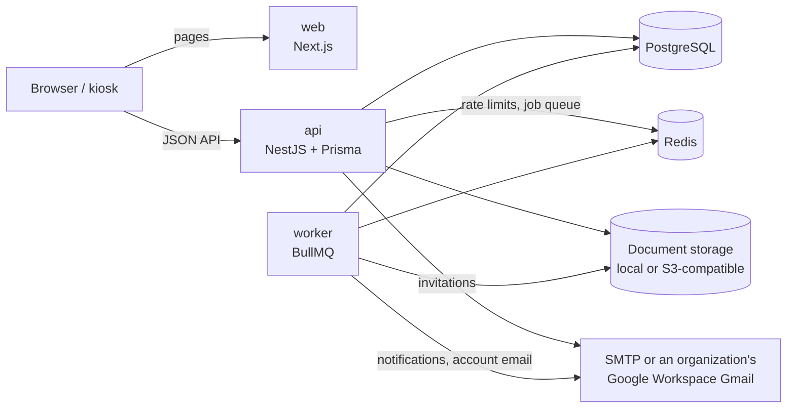

- **Web** (`apps/web`): Next.js App Router frontend and the attendance kiosk. The browser calls
  the API directly; access tokens are kept in memory and refreshed through an HttpOnly cookie.
  The UI hides what a user cannot do, but the API decides.
- **API** (`apps/api`): NestJS modules per domain. Business rules, authorization, separation of
  duties and auditing live in services, inside database transactions.
- **Worker** (`apps/worker`): one BullMQ queue (`hrms-default`) for scheduled and enqueued
  jobs, using job handlers compiled from the API package.
- **Data**: one PostgreSQL database managed by Prisma migrations. Most cross-record links use
  composite keys on `[id, organizationId]`, so the database refuses links across organizations.

Details and further diagrams: [docs/architecture/README.md](docs/architecture/README.md).

## Technology stack

| Layer          | Technology                                                                                                |
| -------------- | --------------------------------------------------------------------------------------------------------- |
| Runtime        | Node.js 24.10 or newer, TypeScript, pnpm 12 workspaces, Turborepo                                         |
| Frontend       | Next.js 16.4 (App Router), React 19.2, Tailwind CSS 4, React Hook Form, Zod 4                             |
| API            | NestJS 12, class-validator DTOs, Prisma 7 with the `pg` driver adapter, Argon2id, `jose` (JWT)            |
| Data and queue | PostgreSQL 17 (Docker Compose; 16 also works locally), Redis 7, BullMQ 6, ioredis                         |
| Integrations   | Nodemailer (SMTP), S3-compatible storage via `aws4fetch`, optional Google Workspace connection            |
| Testing        | Vitest 4, Testing Library, Playwright (Chromium) with axe-core, Node test runner (worker), oxlint, ESLint |
| Tooling        | Prettier, Docker Compose for local PostgreSQL and Redis, GitHub Actions workflow definitions              |

## Repository structure

```text
apps/
  web/          Next.js frontend and attendance kiosk (README: apps/web/README.md)
  api/          NestJS REST API, Prisma client, demo seed in apps/api/demo (apps/api/README.md)
  worker/       BullMQ worker (apps/worker/README.md)
packages/
  config/       @hrms/config: Zod environment validation used by the API
  validation/   @hrms/validation: shared password policy used by the API
prisma/         schema.prisma and 62 migrations
scripts/        demo.mjs (one-command local demo)
docs/           architecture, testing, security, deployment, operations, design, walkthroughs
.github/        CI workflow definitions
```

## Local installation and quick start

Requirements: Node.js 24.10 or newer, pnpm (`corepack enable` uses the version pinned in
`package.json`) and Docker. Without Docker, run your own local PostgreSQL and Redis.

### Fastest path: the demo

```bash
pnpm install
pnpm demo
```

`pnpm demo` (`scripts/demo.mjs`) creates `.env` from `.env.example` if it is missing, starts
PostgreSQL and Redis with `docker compose up -d --wait`, generates the Prisma client, builds the
API and worker, creates and migrates a separate `hrms_demo` database, seeds it through the API,
and starts the API on `:3001`, the worker and the web app on <http://localhost:3000>. It prints
the demo accounts and their generated passwords.

With PostgreSQL and Redis already running at the addresses in `.env`:

```bash
pnpm demo --no-docker
```

Other options: `--setup-only` (prepare without starting the applications), `--reset-passwords`,
and `pnpm demo:reset` (drop and recreate the local demo database after typing its name).

### Development against your own database

1. Copy `.env.example` to `.env` and fill in local values (at least a 32-byte
   `JWT_ACCESS_SECRET`).
2. Start the services and prepare the database (Compose publishes PostgreSQL and Redis on
   `127.0.0.1` only):

   ```bash
   docker compose up -d
   pnpm db:generate
   pnpm db:migrate:deploy
   pnpm db:seed
   ```

3. Build the API, synchronize the permission catalog and grant the System Owner role:

   ```bash
   pnpm build:api
   pnpm --dir apps/api run authz:sync-permissions
   pnpm --dir apps/api run authz:bootstrap-owner -- --email admin@local.test
   ```

4. Start the web app, API and worker:

   ```bash
   pnpm dev
   ```

`pnpm db:seed` creates one local account, `admin@local.test` with the password `Admin123!`
(no organization or roles). It is idempotent and never part of a build or deployment. It runs only
against a database on this machine named `hrms` (or `<name>_dev`) that is really the database the
URL names, refuses `NODE_ENV=production`, and will not add the account to a database that already
holds other accounts unless you confirm with `HRMS_DEV_SEED_CONFIRM=<database name> pnpm db:seed`.
A local host is not proof that a database is disposable (a tunnel can lead anywhere), so these
checks reduce accidents rather than guarantee isolation. Never use these credentials outside a
local database.

After changing `prisma/schema.prisma`, create a migration with
`pnpm db:migrate:dev --name <migration_name>`.

## Fictional demonstration environment

The demo runs **locally only**. It seeds "Harbourline Group", a fictional group with two
organizations (an outdoor centre in Toronto paid in CAD and a studio in Kolkata paid in INR),
eight accounts on the reserved `demo.harbourline.test` domain, and invented employees,
schedules, attendance, leave, payroll runs, recruitment, benefits, performance and a generated
sample PDF. Passwords are generated per clone and kept in the git-ignored
`.demo/credentials.json`.

The demo commands refuse any database that is not a local, marked `*_demo` database holding only
demo data, so they cannot modify a development or production database. There is no hosted
public demo mode. Details: [docs/development/demo.md](docs/development/demo.md).

## Automated testing

| Layer                                                    | Command                                                                         |
| -------------------------------------------------------- | ------------------------------------------------------------------------------- |
| Format, lint, typecheck                                  | `pnpm format:check`, `pnpm lint`, `pnpm --filter web typegen`, `pnpm typecheck` |
| Unit tests (API and web Vitest, worker Node test runner) | `pnpm test`                                                                     |
| API database integration                                 | `pnpm --filter api test:db`                                                     |
| API HTTP end-to-end, including a check over every route  | `pnpm --filter api test:e2e`                                                    |
| Browser, API mocked, axe checks, production build        | `pnpm --filter web test:e2e`                                                    |
| Browser against the real API and a disposable database   | `pnpm --filter web test:e2e:real`                                               |
| Demo smoke test (after `pnpm demo`)                      | `pnpm --filter web test:e2e:demo`                                               |

The integration and browser suites need local PostgreSQL and Redis and a migrated database.
All suites have been run locally. An intermittent database test failure (an audit entry not
found under parallel load) was traced to another test's cleanup deleting entries it did not own,
and fixed; see [docs/testing.md](docs/testing.md#resolved-intermittent-invitation-role-race-failure).
GitHub Actions workflows (`.github/workflows/ci.yml` and `integration.yml`) have passed on
the public portfolio repository's `main` commit `e515e4a` (all seven jobs, including the
browser and demo suites). Details: [docs/testing.md](docs/testing.md).

## Security architecture

- **Authentication:** Argon2id password hashing; sign-in rate limits in Redis (failing closed
  if Redis is unavailable); account lock after five failures for 15 minutes; 15-minute JWT
  access tokens held in memory; rotating refresh tokens stored as SHA-256 hashes in an HttpOnly,
  `SameSite=Lax` cookie scoped to `/auth`, with reuse detection; the session is checked on
  every request.
- **Authorization:** every non-public controller requires an access token; permissions are
  checked in services against the target's organization, unit, department or team; separation
  of duties prevents approving your own leave, timesheet or pay.
- **Kiosk:** enrolled devices hold a hashed device secret; employees use 6-digit Argon2id-hashed
  PINs with lockout and multi-level failure limits; the kiosk sees a first name and generic
  warnings only.
- **HTTP:** request body whitelisting, strict security headers and CSP, CORS limited to
  `WEB_ORIGIN`, HSTS in production from both the web app and the API.
- **Audit log:** append-only through database triggers (updates and truncation refused; deletion
  only by the retention purge, for organization entries older than that organization's
  configured retention period, at least 24 months, and off unless configured). A database role that owns the
  table can disable those triggers, so a **separate least-privilege runtime database role** and a
  migration/owner role are a prerequisite for a hardened production deployment.

No external penetration test has been performed. Details:
[docs/security.md](docs/security.md).

## Known limitations and deployment prerequisites

- **Not production-certified.** The configuration for a deployment (web, API and worker
  services with PostgreSQL, Redis, optional S3-compatible storage and SMTP) is documented in
  [docs/deployment.md](docs/deployment.md), but no production deployment has been verified.
- **Payroll prepares gross pay only.** Statutory deductions (income tax and other jurisdictional
  withholdings) and net pay are not calculated: runs carry `statutoryStatus = NOT_CALCULATED`,
  and the payroll pages and register say so.
- **Not an unrestricted public hosted demo.** The demonstration is designed for local use; a
  hosted instance would need its own access controls and isolation.
- **Database role separation** (see [Security architecture](#security-architecture)) is required
  before a hardened production release.
- **Browser tests use Chromium only.** No Safari or Firefox runs, no testing with a real screen
  reader and no testing on kiosk hardware; axe checks are automated, not a WCAG conformance audit.
- **No multi-factor authentication or single sign-on.** The Google OAuth flow connects an
  organization's Google Workspace for integrations; it is not a sign-in method.
- **Not every out-of-scope record answers 404.** Some identifiers outside the caller's scope
  answer 403 without returning data.
- **No malware scanner is bundled.** `DOCUMENT_REQUIRE_MALWARE_SCAN=true` refuses unscanned
  files.
- **Email** needs an SMTP server or a Google Workspace connection; otherwise it is suppressed.
- **The demo runs the web app under `next dev`,** because a production web build requires an
  HTTPS API origin.

## Documentation

| Document                                                                       | Contents                                         |
| ------------------------------------------------------------------------------ | ------------------------------------------------ |
| [docs/architecture/README.md](docs/architecture/README.md)                     | Architecture and diagrams                        |
| [docs/testing.md](docs/testing.md)                                             | Test layers, commands and current results        |
| [docs/security.md](docs/security.md)                                           | Security design, controls and known limits       |
| [docs/deployment.md](docs/deployment.md)                                       | Deployment topology and prerequisites            |
| [docs/development/demo.md](docs/development/demo.md)                           | The local demo: setup, accounts, dataset, guards |
| [docs/walkthroughs.md](docs/walkthroughs.md)                                   | Feature walkthroughs using the demo              |
| [docs/operations/time-attendance.md](docs/operations/time-attendance.md)       | Operating time and attendance                    |
| [docs/operations/employee-lifecycle.md](docs/operations/employee-lifecycle.md) | Hiring, transfers, terminations, rehires         |
| [docs/design/design-system.md](docs/design/design-system.md)                   | UI building blocks and accessibility conventions |
| [apps/api/README.md](apps/api/README.md)                                       | The API application                              |
| [apps/web/README.md](apps/web/README.md)                                       | The web application                              |
| [apps/worker/README.md](apps/worker/README.md)                                 | The background worker                            |

`docs/security/sql/` contains read-only operator and diagnostic SQL queries; some database tests
load them.

## License

Copyright © 2026 Rahil Ashraf. All rights reserved.

The source code is published for professional portfolio evaluation. This project is not open
source. No license is granted to copy, modify, distribute, sublicense, deploy or reuse it,
except as permitted by applicable law or by the hosting platform's terms of service (GitHub's
terms allow viewing and forking public repositories). Third-party dependencies, fonts and other
materials remain under their own licenses. See [LICENSE](LICENSE).
