# Architecture

This document describes how Portfolio HRMS is built: the code layout, the three runtime
applications, the data model's organization and permission boundaries, and the main
workflows. Each section names the source files it describes, so the text can be checked
against the code. Where the code and this document disagree, the code is authoritative.

## Contents

1. [Monorepo](#1-monorepo)
2. [System context](#2-system-context)
3. [Runtime components](#3-runtime-components)
4. [Next.js frontend](#4-nextjs-frontend)
5. [NestJS API](#5-nestjs-api)
6. [PostgreSQL and Prisma](#6-postgresql-and-prisma)
7. [Redis, BullMQ and background jobs](#7-redis-bullmq-and-background-jobs)
8. [Authentication and sessions](#8-authentication-and-sessions)
9. [Organization and permission scope model](#9-organization-and-permission-scope-model)
10. [Scheduling, attendance and payroll data](#10-scheduling-attendance-and-payroll-data)
11. [Documents and storage abstraction](#11-documents-and-storage-abstraction)
12. [Notifications and email](#12-notifications-and-email)
13. [Deployment topology](#13-deployment-topology)
14. [Testing layers](#14-testing-layers)

## 1. Monorepo

pnpm workspaces (`pnpm-workspace.yaml`) with Turborepo (`turbo.json`). Node.js 24.10 or newer.

| Path                  | Package            | Purpose                                                               |
| --------------------- | ------------------ | --------------------------------------------------------------------- |
| `apps/web`            | `web`              | Next.js 16 / React 19 frontend, including the onsite attendance kiosk |
| `apps/api`            | `api`              | NestJS REST API; owns the Prisma client and all business rules        |
| `apps/worker`         | `worker`           | BullMQ worker; runs job handlers compiled from `apps/api`             |
| `packages/config`     | `@hrms/config`     | Zod environment validation, used by the API                           |
| `packages/validation` | `@hrms/validation` | Shared password policy (12 to 128 characters), used by the API        |
| `prisma/`             | —                  | `schema.prisma` and the migration history (62 migrations)             |

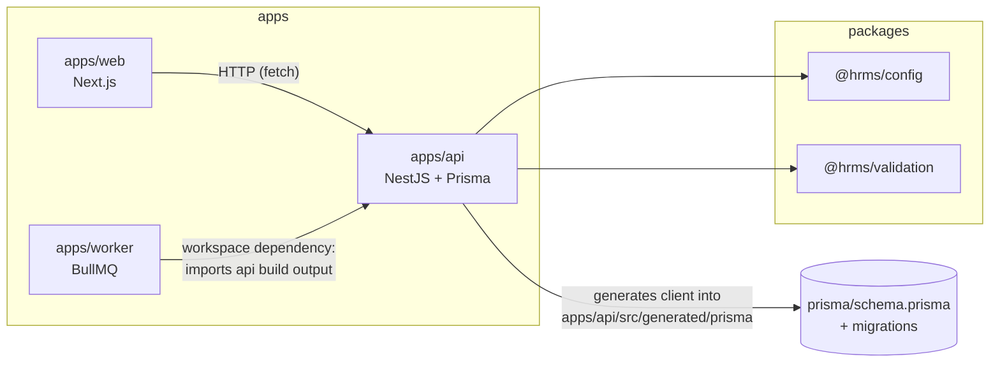

The web app shares no code with the API; it talks to it only over HTTP. Turborepo builds the
API (after `prisma generate`) before the worker, because the worker imports the API's compiled
job modules through the `exports` map in `apps/api/package.json`.

## 2. System context

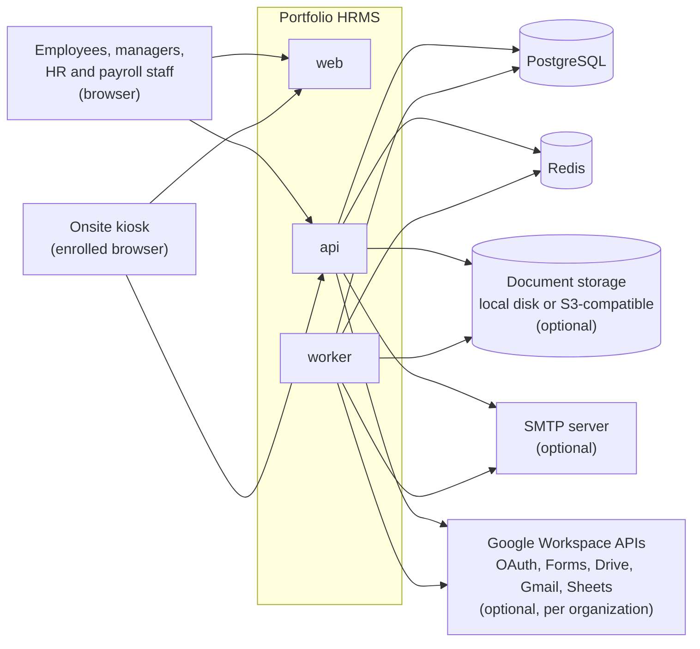

- Without document storage configured (`DOCUMENT_STORAGE_DRIVER=none`, the default) uploads
  are refused; references to external files can still be recorded.
- Without SMTP or a Google Workspace connection, email is suppressed (in production, account
  email then answers 503 instead of pretending to send).
- The Google Workspace connection is made per organization through OAuth
  (`apps/api/src/integrations/google`). It is used to read bound Google Forms, check Drive
  references, send email through Gmail and export reports to Sheets. It is not a sign-in
  method.
- No other external services are integrated. There is no bundled malware scanner, no payment
  or statutory-payroll provider and no single sign-on.

## 3. Runtime components

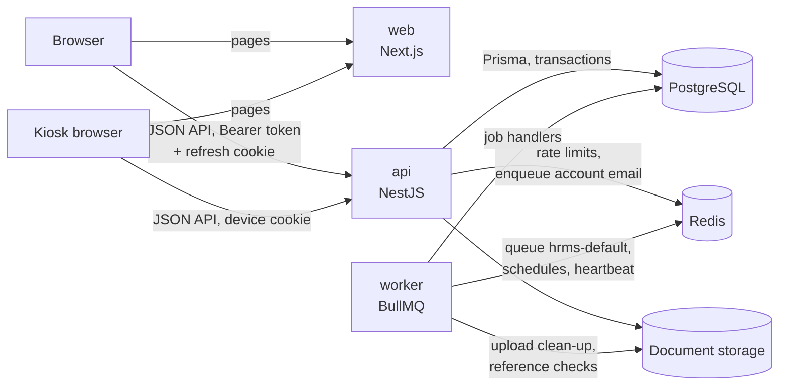

The browser calls the API directly from client components; the Next.js server does not proxy
API requests.

## 4. Next.js frontend

`apps/web/src` (details in [apps/web/README.md](../../apps/web/README.md))

- **API access:** `lib/api-config.ts` reads `NEXT_PUBLIC_API_URL` (an origin; HTTPS required for
  production builds). `lib/auth/api-client.ts` keeps the access token in memory only, sends it as
  a Bearer token, and on a 401 refreshes once through `POST /auth/refresh` (the HttpOnly cookie)
  and retries. A 403 `PASSWORD_CHANGE_REQUIRED` sends the user to the password change; a 429
  surfaces `Retry-After`.
- **Route groups:** `app/(app)` holds sign-in, password recovery, invitations and email
  verification. `app/(app)/(authenticated)` wraps every signed-in page in `ProtectedRoute`,
  `WorkspaceProvider` and `AppShell`. `app/(kiosk)/kiosk` is the attendance kiosk.
- **Permission gating** (`components/ui/require-permission.tsx`, `lib/authorization/`) only
  hides what a user cannot use. It is presentation, not security: the API decides.
- **Security headers** for pages come from `next.config.ts` `headers()`
  (`lib/security/page-headers.ts`): a Content Security Policy, baseline headers and, outside
  development, HSTS (`max-age=31536000`). There is no Next.js middleware.
- **UI building blocks** (`components/ui/`) and accessibility conventions are described in
  [docs/design/design-system.md](../design/design-system.md).

## 5. NestJS API

`apps/api/src` (details in [apps/api/README.md](../../apps/api/README.md)). Feature modules are
registered in `app.module.ts`; the HTTP pipeline is built in `config/http-application.ts`.

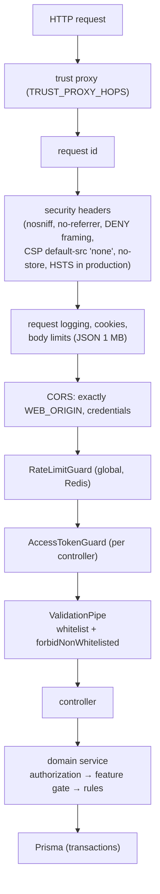

Feature folders: `auth`, `sessions`, `users`, `authorization`, `organization`, `employee`, `time`,
`scheduling`, `calendar`, `leave`, `compensation`, `kiosk`, `payroll`, `benefits`, `performance`,
`recruitment`, `onboarding` (onboarding and offboarding), `documents`, `notifications`,
`integrations/google`, `reporting`, `features`, `branding`, `workspace`, `audit`, plus
infrastructure (`health`, `observability`, `rate-limit`, `redis`, `database`, `email`,
`retention`, `security`). Requests carry no API version prefix.

Business rules live in services, not controllers. Concurrency is handled per workflow: timesheet
review and the feature and branding settings take an `expectedVersion`; clock, kiosk and leave
ledger actions take an idempotency key; status transitions are conditional updates inside a
transaction, so of two people acting at once only one succeeds.

## 6. PostgreSQL and Prisma

- One PostgreSQL database; schema `prisma/schema.prisma`, migrations in `prisma/migrations`,
  applied with `pnpm db:migrate:deploy`. Prisma 7 uses the `pg` driver adapter.
- Times are stored as `timestamptz` instants. Local dates (work dates, leave days, pay periods)
  are computed in an IANA time zone (`common/timezone.ts`).
- Money is decimal with an explicit ISO 4217 currency on each record (`CompensationRecord`,
  `PayrollRun`, `BenefitPlan`); currency is never inferred from the organization.
- Many cross-record links use composite foreign keys on `[id, organizationId]` (role-assignment
  scopes, pay groups, payroll periods and runs), so the database itself refuses a link between
  records of different organizations. Not every link does: for example a position's unit,
  department and team, and an assignment's manager, are linked on `id` alone and checked in
  services.
- Changes to people, access, time, pay and documents write `AuditLog` rows, viewable per
  organization. Database triggers refuse `UPDATE` and `TRUNCATE` on `AuditLog`; `DELETE` is
  allowed only for the retention purge of entries older than 24 months. A role that owns the
  table can disable the triggers, so a hardened deployment needs a separate least-privilege
  runtime role (see [docs/security.md](../security.md)).

## 7. Redis, BullMQ and background jobs

`apps/worker/src` (details and the full job table in
[apps/worker/README.md](../../apps/worker/README.md)). One BullMQ queue, `hrms-default`, is
consumed by one `Worker` (`WORKER_CONCURRENCY`, default 1). Repeatable schedules are registered at
start-up with `upsertJobScheduler` in UTC (`schedules.ts`); the handlers are the API's compiled
job modules (`apps/api/src/*/*-jobs.ts`).

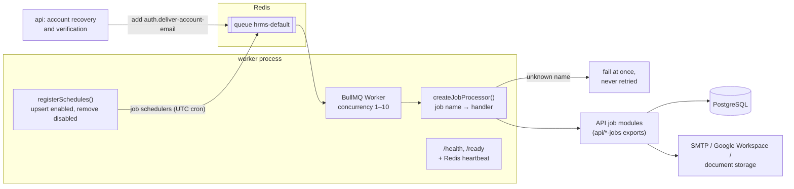

| Kind                | Jobs                                                                                                                                                                                                                                                                                                                                                                                                  |
| ------------------- | ----------------------------------------------------------------------------------------------------------------------------------------------------------------------------------------------------------------------------------------------------------------------------------------------------------------------------------------------------------------------------------------------------- |
| Always scheduled    | shift generation, leave entitlements, assignment activation, open time-entry scan, payroll period preparation, evidence and application sync, offer expiry, onboarding/performance/recruitment reminders, document expiry reminders, reference checks and upload clean-up, notification publishing and delivery (every 2 minutes), Google Forms sync and health check, retention, auth-record pruning |
| On unless disabled  | retained-grant reconciliation (`RETAINED_GRANT_RECONCILIATION_ENABLED`)                                                                                                                                                                                                                                                                                                                               |
| Off unless enabled  | `TIME_ATTENDANCE_AUTOMATION_ENABLED` (attendance period preparation, no-show detection); `EMPLOYEE_LIFECYCLE_AUTOMATION_ENABLED` (due terminations, due assignment ends). A switched-off group's schedules are removed at start-up.                                                                                                                                                                   |
| Enqueued by the API | `auth.deliver-account-email` (password resets and email verification)                                                                                                                                                                                                                                                                                                                                 |

`AUTH_RECORD_RETENTION_ENABLED` must be `true` before the pruning job deletes anything, and data
retention applies only to organizations that opted in. Payroll preparation creates periods and
timesheets but never calculates or finalizes a run.

Redis also holds the API's rate-limit counters (sign-in, kiosk PIN failures and per-route
policies).

## 8. Authentication and sessions

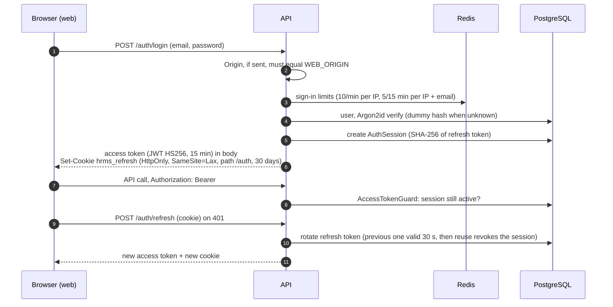

- Access tokens live only in browser memory; a page reload refreshes from the cookie. Because the
  cookie is `SameSite=Lax`, the web and API origins must be same-site.
- Sign-in rate limiting fails closed: if Redis is unavailable, sign-in answers 503.
- Five failed sign-ins lock an account for 15 minutes.
- Invitations, password resets and email verification use single-use random tokens stored as
  SHA-256 hashes, with lifetimes of 7 days, 30 minutes and 24 hours. Password-reset and
  verification emails are queued for the worker, so the API answers the same way whether or not
  an address exists; invitations are sent by the API directly.
- An administrator can require a password change; the API then refuses every other request with
  403 `PASSWORD_CHANGE_REQUIRED`.
- **Kiosk:** a device is enrolled with a one-time 15-minute code and then holds a device secret in
  the `hrms_kiosk` cookie (stored hashed). Employees identify with a 6-digit PIN (Argon2id); PIN
  failures are rate-limited per device, employee and organization.
- Not implemented: multi-factor authentication and single sign-on.

## 9. Organization and permission scope model

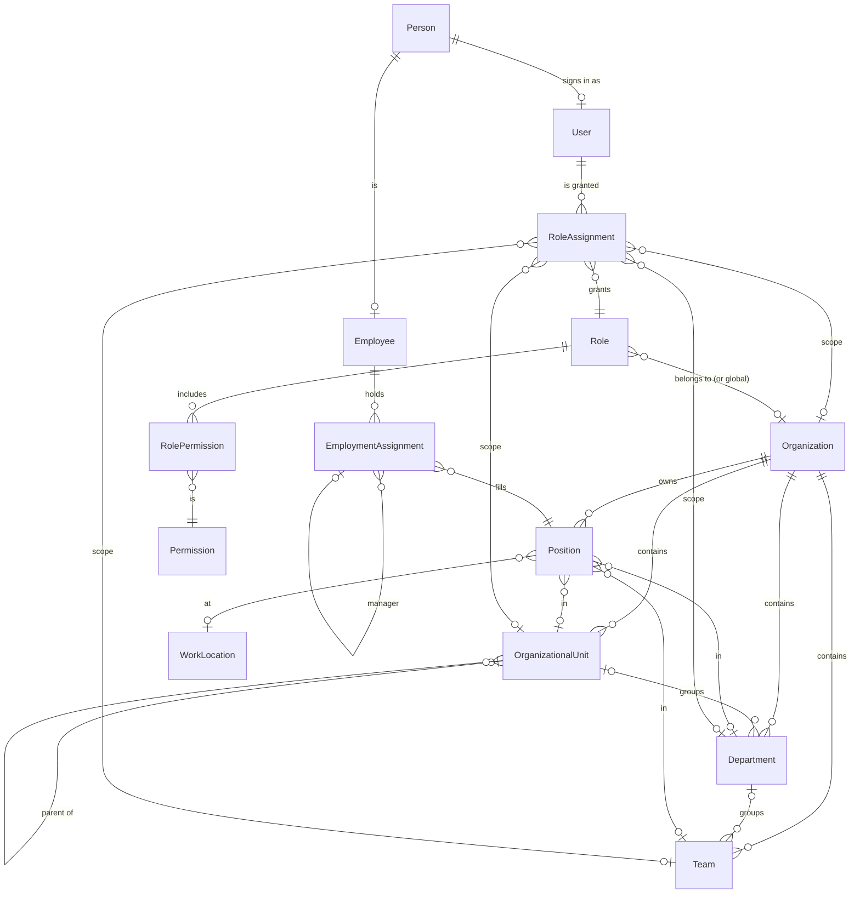

- An employee's organization is never a field on `Employee`: it comes from the position each
  `EmploymentAssignment` fills. One person can therefore work in several organizations, each
  assignment with its own manager, pay, schedule and time zone (the work location's, else the
  organization's).
- A `RoleAssignment` has a scope type (`SYSTEM`, `ORGANIZATION`, `ORGANIZATIONAL_UNIT`,
  `DEPARTMENT`, `TEAM`) and is effective between `startsAt` and `expiresAt` unless revoked.

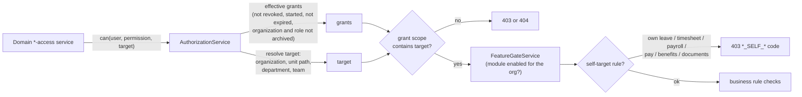

- Scope containment (`authorization/authorization.policy.ts`): `SYSTEM` covers everything; an
  `ORGANIZATION` grant covers its organization; an `ORGANIZATIONAL_UNIT` grant covers targets
  whose unit path includes that unit (so a grant on an ancestor covers its descendants); a
  `DEPARTMENT` grant covers the department and its teams; a `TEAM` grant covers the team.
- Permissions are checked in services (`authorization/authorization.service.ts` and one
  `*-access.service.ts` per domain), not by route decorators, because almost every decision
  depends on the target record's organization and unit. Every non-public controller uses
  `AccessTokenGuard`.
- The catalog has 74 permissions (`authorization/authorization-catalog.ts`). Role templates
  (`authorization/role-templates.ts`) cover organization, HR, payroll, time and attendance
  administrators, schedulers, recruiters, managers, employees and auditors. The System Owner
  role is reserved and granted only by the `authz:bootstrap-owner` command.
- **Separation of duties:** nobody approves their own leave, timesheet or payroll, adjusts their
  own leave or payroll, or manages their own compensation, benefits or documents.
- **Isolation:** queries are filtered by the organizations the caller's grants cover. An
  out-of-scope candidate, leave request, document, piece of evidence or role answers 404. Some
  other resources (organization structure details, payroll runs, benefit plans, pay groups,
  performance cycles, kiosk devices, assignment-scoped compensation and benefits routes) answer
  403 for an existing identifier, without returning data.

## 10. Scheduling, attendance and payroll data

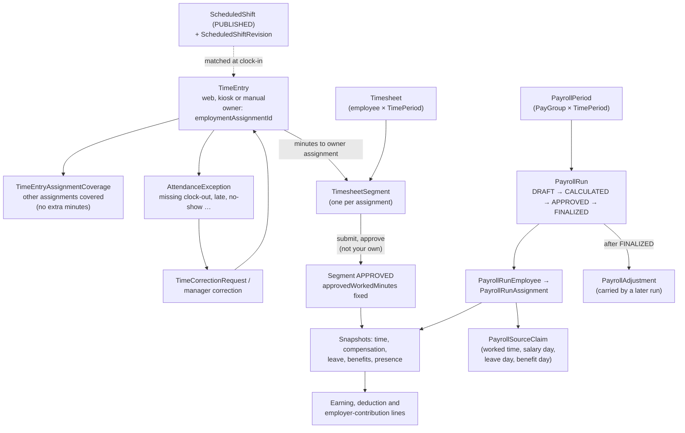

Other payroll inputs are effective-dated `CompensationRecord`s, approved leave days and benefit
enrollments. Published schedules and presence records are shown for context only; payroll never
pays from schedules.

- **Multi-assignment attendance** (`time/time-coverage.ts`): one `TimeEntry` is one physical work
  interval. Its `employmentAssignmentId` is the payroll owner, and timesheet segments, payroll and
  reports attribute the interval's minutes to that assignment only. Coverage rows name the other
  assignments it covers (at most 10 in total) and never add time, so the interval is paid once.
- **Time zones:** work dates, overnight shifts and daylight-saving transitions are computed in the
  shift's IANA time zone. Policies are layered: system, organization, unit, department, team,
  assignment (`TimeAttendancePolicy`).
- **Exceptions:** blocking exceptions prevent timesheet submission. Attendance recorded after
  approval raises an exception instead of silently changing an approved timesheet.
  Presence-only sign-ins and sign-outs (`AttendanceSignIn`/`AttendanceSignOut`) record who is on
  site without creating payable minutes.
- **Payroll** (`payroll/payroll-engine.ts`, `payroll/payroll-source.service.ts`): a calculation
  snapshots its inputs and claims each source (`PayrollSourceClaim`), so the same hours, salaried
  day or leave day cannot be paid by two live runs. A finalized run is never rewritten; later
  changes become `PayrollAdjustment` records carried by the next run. Approval requires a
  different person from the one whose pay is affected.
- **Not calculated:** statutory deductions and net pay. `PayrollRun.statutoryStatus` defaults to
  `NOT_CALCULATED`; only an interface exists (`payroll/statutory/statutory-payroll.contracts.ts`),
  and the payroll pages and register say so.
- Operating details: [docs/operations/time-attendance.md](../operations/time-attendance.md) and
  [docs/operations/employee-lifecycle.md](../operations/employee-lifecycle.md).

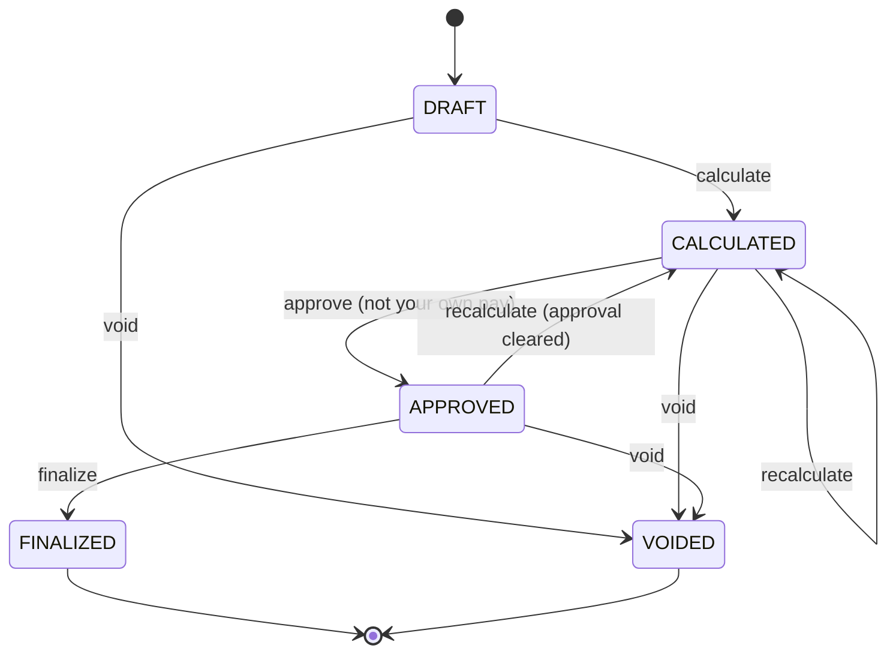

## 11. Documents and storage abstraction

Two boundaries in `apps/api/src/documents`:

- **Object store** (`document-object-store.ts`): `documentStorageFromEnv` selects the driver from
  `DOCUMENT_STORAGE_DRIVER`: `none` (the default; uploads are refused), `local`
  (`LocalDocumentObjectStore`: files under `DOCUMENT_STORAGE_LOCAL_DIR` and HMAC-signed download
  links; refused in production unless `DOCUMENT_STORAGE_ALLOW_LOCAL_IN_PRODUCTION=true`) or `s3`
  (`S3DocumentObjectStore`: any S3-compatible endpoint, requests signed with `aws4fetch`, HTTPS
  required in production). Object keys are `documents/<organizationId>/<objectId>`.
- **Storage adapters** (`document-storage.contract.ts`): provider-neutral reference checks for
  stored versions. `documents.module.ts` registers a Google Drive adapter (used only where the
  organization has a Google Workspace connection) and, when an object store is configured,
  `InternalObjectStorageAdapter`; the worker's `documents.verify-references` job uses the same
  set.

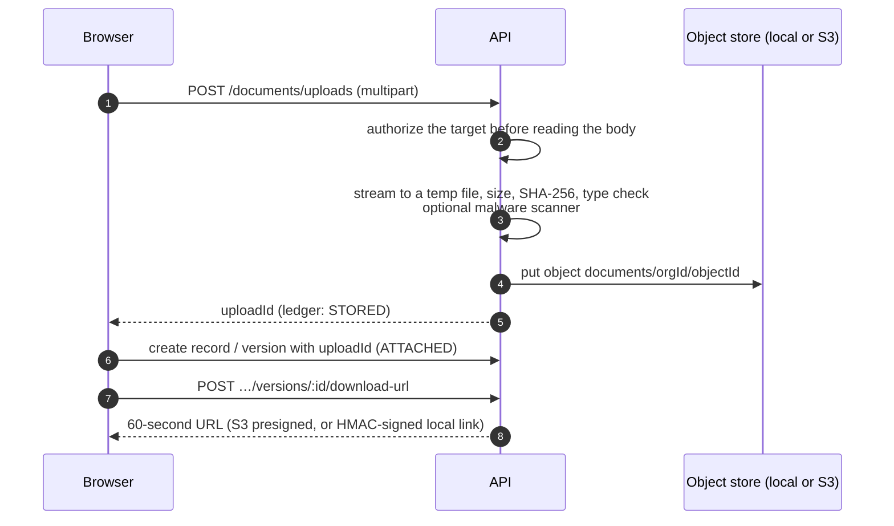

- PDF, PNG and JPEG; 10 MB by default (`DOCUMENT_UPLOAD_MAX_BYTES`, at most 25 MB).
- Confidentiality: `EMPLOYEE_VISIBLE`, `MANAGER_VISIBLE`, `HR_ONLY`, `RESTRICTED`.
- A worker job removes uploads never attached within 24 hours.
- No malware scanner is bundled. `DOCUMENT_REQUIRE_MALWARE_SCAN=true` refuses files that were not
  scanned.

## 12. Notifications and email

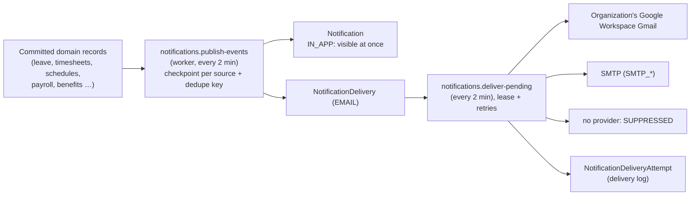

- Notifications are derived from records that have already committed, by reading forward from a
  stored checkpoint (`NotificationProducerCheckpoint`), rather than published from inside request
  transactions. A failed request therefore never notifies, and a restarted worker resumes where it
  stopped.
- Users choose email preferences per category; security and required HR messages cannot be
  turned off.
- Account email (invitations from the API; password resets and verification from the worker)
  uses the same order: the organization's Gmail connection, else SMTP, else a development
  fallback that refuses in production.

## 13. Deployment topology

The applications are three independent processes built from this repository. A deployment
needs:

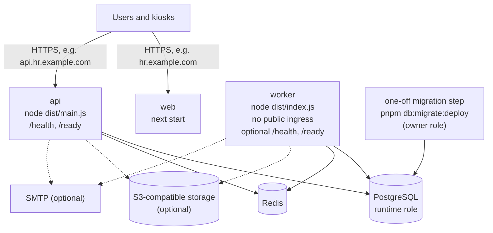

- Web and API must be same-site (for example `hr.example.com` and `api.hr.example.com`) for the
  refresh cookie; `WEB_ORIGIN` and `NEXT_PUBLIC_API_URL` name each other's origins, and the web
  build requires an HTTPS API origin.
- `TRUST_PROXY_HOPS` must match the real proxy chain in front of the API.
- Migrations run once per release before the new API starts, never from application start-up.
  The first account is created with `authz:create-initial-user` and `authz:bootstrap-owner`, never
  with the development seed.
- The API's `/health` is liveness; `/ready` checks PostgreSQL and Redis. The worker serves the
  same probes on `WORKER_HEALTH_PORT` when set.
- No production deployment has been verified. Prerequisites, including the separate runtime and
  migration database roles, are in [docs/deployment.md](../deployment.md).

## 14. Testing layers

| Layer                                                                  | Location                                          | Command                           |
| ---------------------------------------------------------------------- | ------------------------------------------------- | --------------------------------- |
| API unit (Vitest)                                                      | `apps/api/**/*.spec.ts`                           | `pnpm --filter api test`          |
| API database integration                                               | `apps/api/test/**/*.db-spec.ts`                   | `pnpm --filter api test:db`       |
| API HTTP end-to-end (includes a route-boundary suite over every route) | `apps/api/test/**/*.e2e-spec.ts`                  | `pnpm --filter api test:e2e`      |
| Web unit (Vitest, Testing Library)                                     | `apps/web/src/**/*.test.{ts,tsx}`                 | `pnpm --filter web test`          |
| Web end-to-end, API mocked, with axe checks                            | `apps/web/e2e/`                                   | `pnpm --filter web test:e2e`      |
| Web end-to-end against a real API and database                         | `apps/web/e2e-real/`                              | `pnpm --filter web test:e2e:real` |
| Demo smoke (eight accounts)                                            | `apps/web/e2e-demo/`                              | `pnpm --filter web test:e2e:demo` |
| Worker (Node test runner)                                              | `apps/worker/src/jobs.test.ts`, `runtime.test.ts` | `pnpm --filter worker test`       |

Results, environment requirements and known open issues: [docs/testing.md](../testing.md).
