# Feature walkthroughs

Short tours of Portfolio HRMS using the synthetic demo (`pnpm demo`, described in
[development/demo.md](development/demo.md)). Each walkthrough names the demo account to sign in
with, where to go, what the seeded data shows and the engineering decision behind it.

Demo accounts are `<name>@demo.harbourline.test`; their passwords are generated for your clone
and printed by `pnpm demo` (also in `.demo/credentials.json`). Dates are relative to the demo's
reference week, so the exact dates you see differ from the screenshots.

**Keeping this page current:** the screenshots are regenerated with
`pnpm --filter web screenshots:demo` against a running demo
(`apps/web/e2e-demo/portfolio-screenshots.capture.ts`). If a walkthrough's page or data
changes, update the capture file, the dataset (`apps/api/demo/`) and this page together. The demo
smoke suite (`pnpm --filter web test:e2e:demo`) checks the main data on each account's pages, and
the capture fails if a page it photographs loses its data; details such as next week's draft
schedule, individual reviews, benefit enrollments and notifications are not checked
automatically.

## 1. Dashboard

**Account:** `hr.admin` (Morgan Achebe, HR administrator, Harbourline Outdoor Centre).

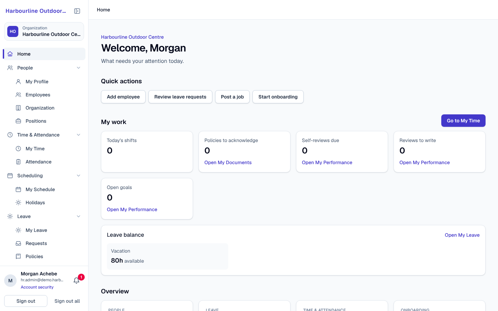

The home page shows quick actions and "My work" cards that depend on what the signed-in person
can do, then organization overview figures.

**Engineering note:** the navigation and quick actions come from the API's capability read
model (`workspace`), computed from the person's grants and the organization's enabled modules.
The UI never decides access by itself; it only stops offering what the API would refuse.

## 2. Employee directory and organization boundaries

**Accounts:** `hr.admin`, then `studio.lead`.

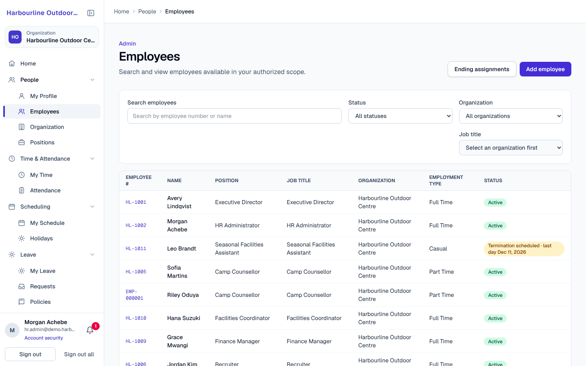

People → Employees lists the Outdoor Centre's ten employees plus a counsellor hired through
recruitment and a seasonal facilities assistant. Sign
in as `studio.lead` (Arjun Mehta): the directory shows only Harbourline Studio's three
employees (the lead and two designers).

**Engineering note:** an employee's organization is not a column on the employee. It comes from
the position each employment assignment fills, so one person can work for both organizations
with separate managers, pay and time zones. Queries are filtered by the organizations the
caller's grants cover. An out-of-scope candidate, leave request or document answers 404 rather
than revealing that it exists; some other records answer 403 (see
[organization boundaries](architecture/README.md#9-organization-and-permission-scope-model)).

## 3. Scheduling

**Account:** `manager` (Daniel Okafor, Programs manager).

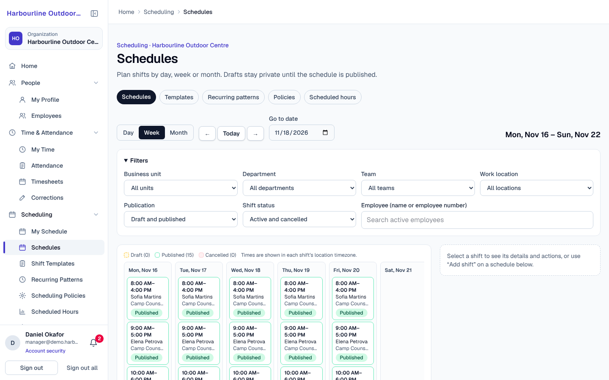

Scheduling → Schedules shows this week's published counsellor shifts. Next week is a draft,
visible to the manager but not yet to the employees.

**Engineering note:** a shift is stored as two instants plus an IANA time zone. Its work date,
overnight handling and daylight-saving behaviour are computed in that zone (the work location's,
else the organization's), so a schedule for Toronto and one for Kolkata are both correct.
Publishing records a revision baseline, so later edits are visible as corrections.

## 4. Time and attendance

**Accounts:** `manager`, then `employee`.

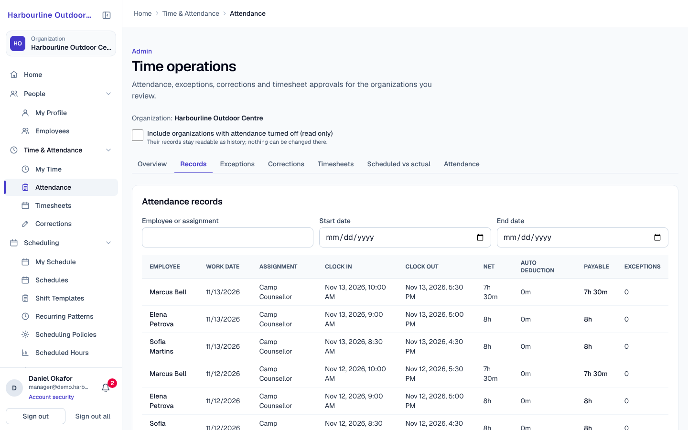

Time & Attendance → Attendance → Records lists the counsellors' clock-ins and clock-outs with
net and payable time. The Timesheets tab holds the approval queue and the time periods; the two
completed periods are approved.

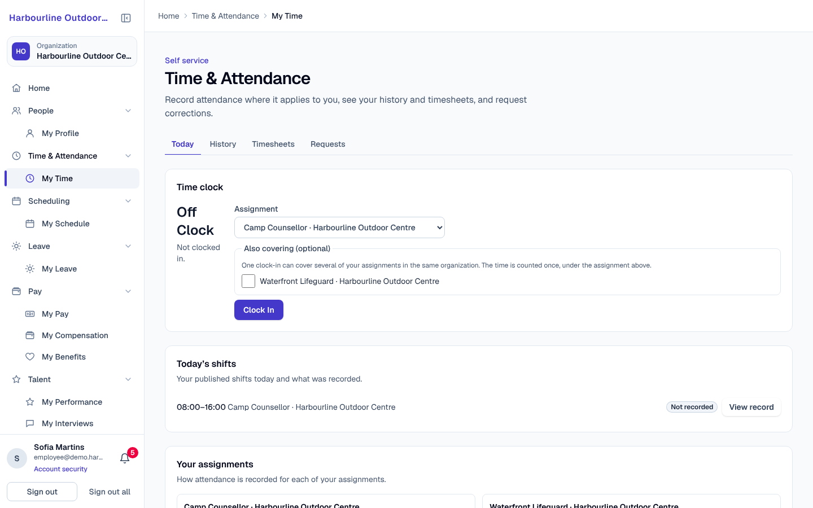

As `employee` (Sofia Martins), My Time shows today's published shift. Sofia has two
assignments, Camp Counsellor and a part-time Waterfront Lifeguard role, and the Programs
department's attendance policy uses a live clock, so the clock-in form asks which assignment the
time is for and offers "Also covering" for the other one. (The screenshot chooses an assignment
but does not clock in.)

**Engineering note:** a timesheet has one segment per assignment, each approved separately by
someone allowed to approve that assignment and never by the employee. Approval stores the
snapshot payroll will use. Time recorded after approval raises an exception instead of silently
changing what was approved.

## 5. Payroll

**Account:** `payroll` (Priya Raman, payroll administrator).

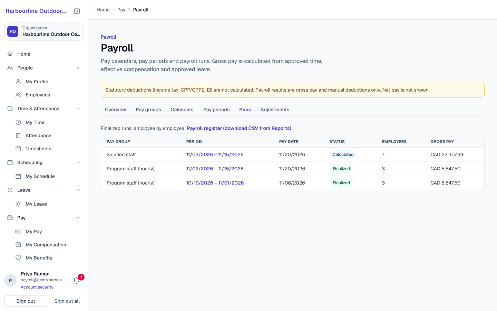

Pay → Payroll → Runs shows two finalized hourly runs and a calculated salaried run.

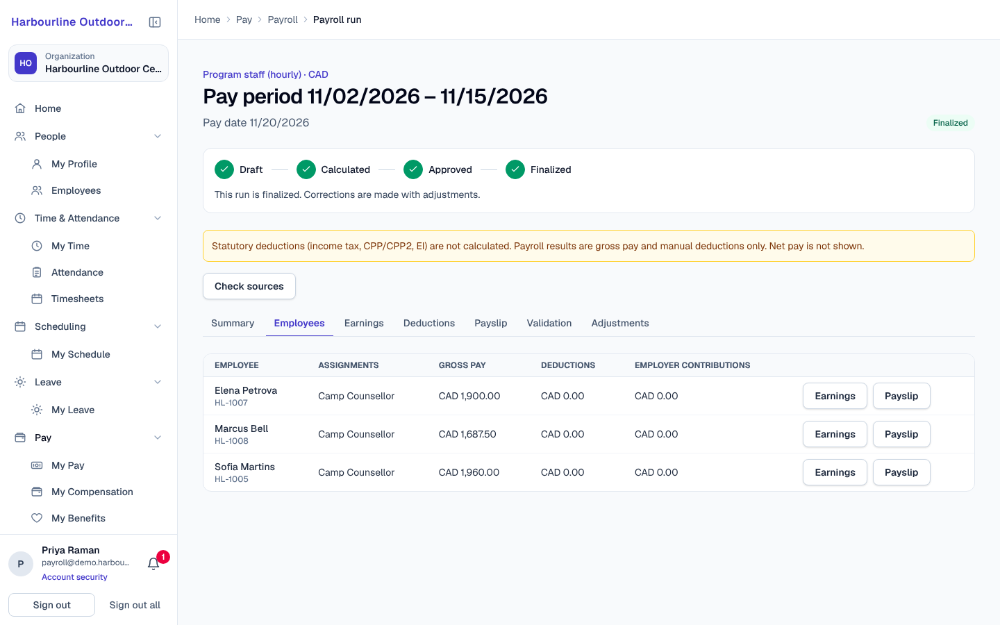

Open the latest hourly run: Draft → Calculated → Approved → Finalized, with each counsellor's
gross pay from approved hours. The summary shows who calculated it (Priya) and who approved and
finalized it (the System Owner): payroll dual control keeps preparation and approval with two
different people. The salaried run stays at Calculated: Priya prepared it and is paid by it, so
the API refuses to let her approve it.

**Engineering notes:**

- A calculation snapshots its inputs (approved time, leave, effective-dated compensation and
  benefit deductions) and claims each source, so the same hours cannot be paid twice.
- A finalized run is never rewritten; later corrections become adjustments in the next run.
- **Statutory deductions and net pay are not calculated**, and every payroll page says so.

## 6. Recruitment

**Account:** `recruiter` (Jordan Kim).

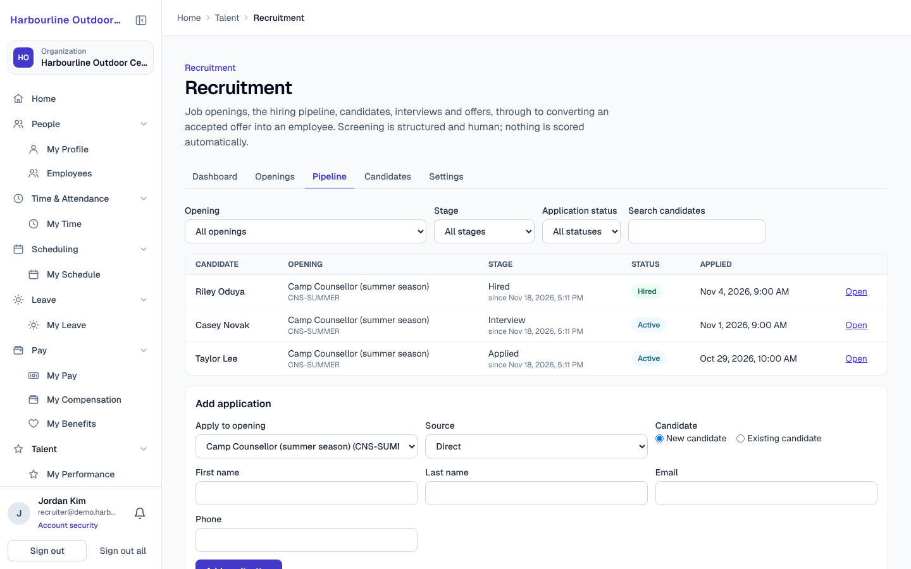

Talent → Recruitment → Pipeline shows three candidates for "Camp Counsellor (summer season)":
one applied, one at interview, and one hired after an offer that HR approved.

**Engineering note:** screening is structured and done by people; nothing is scored
automatically. Hiring converts the accepted offer into an employee and an assignment in an open
position, with the offered compensation, in one step.

## 7. Onboarding

**Account:** `hr.admin`.

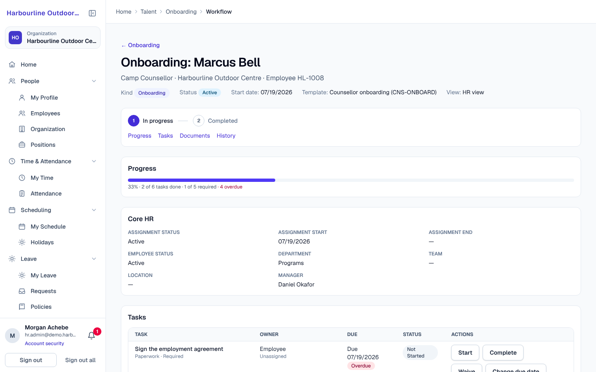

Talent → Onboarding lists the new hire's workflow and a second counsellor's workflow part-way
through, with required tasks, owners, due dates and overdue flags.

**Engineering note:** a workflow copies its template when it starts, so editing the template
later does not change workflows already under way. Each task has an owner (for example the
employee, the manager or HR), and the API checks task ownership before anyone acts on it.

## 8. Performance

**Accounts:** `hr.admin`, `manager`, `employee`.

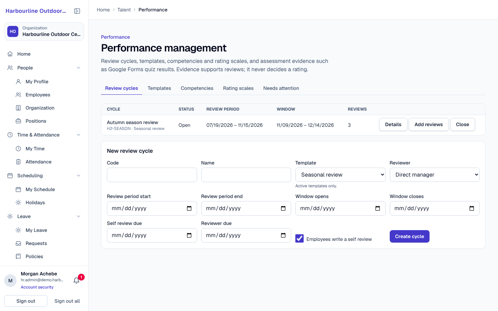

Talent → Performance shows the open "Autumn season review" cycle for the counsellors. Sofia has
submitted her self-review, and Daniel has submitted his review of Elena Petrova.

**Engineering note:** evidence such as Google Forms quiz results supports a review, but a
person always chooses the rating.

## 9. Benefits

**Account:** `hr.admin`.

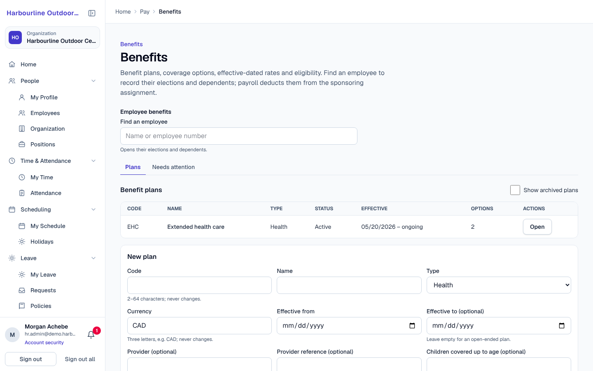

Pay → Benefits shows the extended health plan with single and family coverage. Search for an
employee to see their elections and dependents (the seed has a family enrollment, a single
enrollment and a waiver).

**Engineering note:** rates are effective-dated, and elections become deductions on the payroll
of the assignment that sponsors them. HR cannot manage their own benefits.

## 10. Documents

**Accounts:** `hr.admin`, then `employee`.

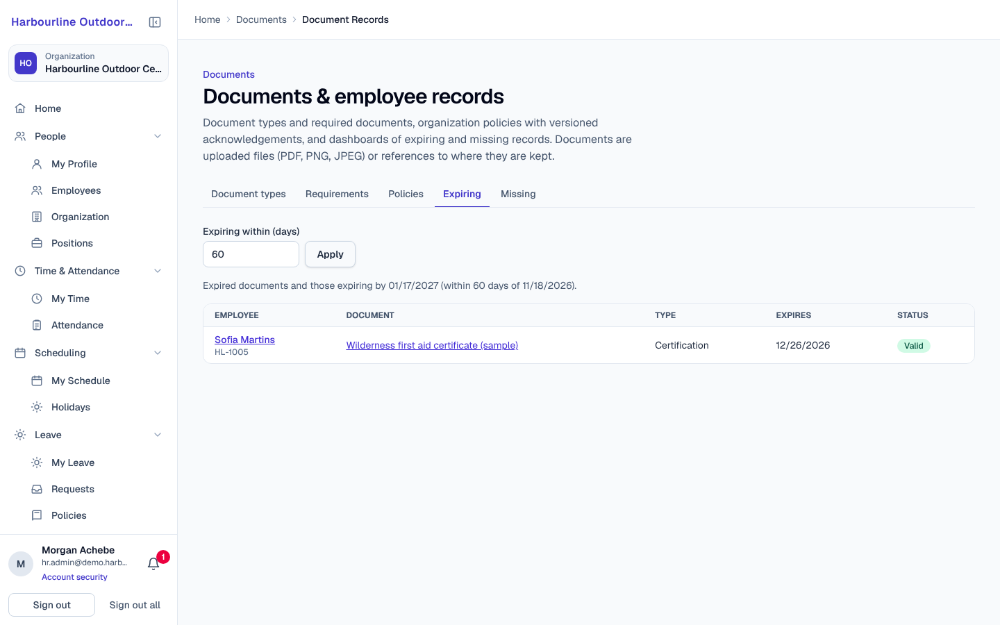

Documents → Expiring, with "Expiring within" set to 60 days, lists Sofia's sample first-aid
certificate. As `employee`, My Documents shows the same certificate, because it is marked
employee-visible.

**Engineering notes:**

- An upload's target is authorized before its body is read; the file is size-checked,
  type-checked and checksummed, and is stored outside the database.
- Downloads use links that expire after 60 seconds.
- Four confidentiality levels decide who can see a record (employee, manager, HR, restricted).
- The sample certificate is a generated PDF labelled as demonstration data.

## 11. Notifications

**Account:** `employee`.

Select the bell in the sidebar. Sofia has notifications for her published schedule, her
approved timesheets and her available pay statements.

**Engineering note:** notifications are produced by the worker from records that have already
been committed, reading forward from a stored checkpoint. A request that fails never notifies,
and duplicates are prevented with a key per event.

## 12. Ending assignments

**Account:** `hr.admin`.

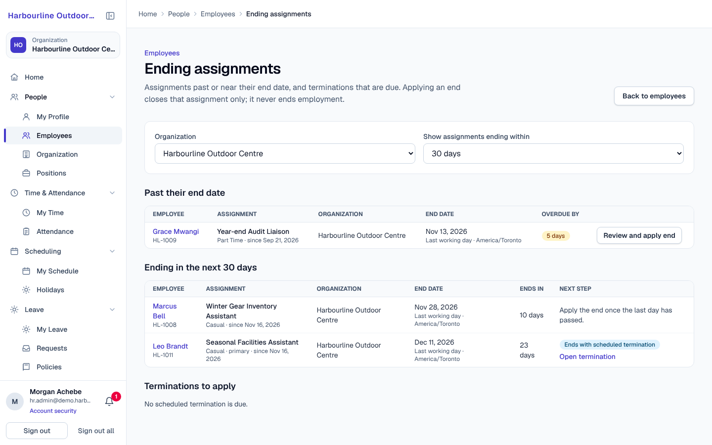

People → Employees → Ending assignments lists assignments past or near their end date. The demo
has one of each case: Grace Mwangi's secondary audit-liaison assignment is **past its end date**
but still active, Marcus Bell's secondary inventory assignment ends **soon**, and Leo Brandt's
assignment ends with his **scheduled termination**. Applying an end is a deliberate action with a
confirmation; it closes that assignment only and never ends employment.

**Engineering note:** the demo keeps lifecycle automation off, so nothing ends by itself. With
automation on, the worker applies due ends and terminations through the same service and audit
path as the manual action. An end date in the past is accepted only as a correction to an active
assignment, which is why the overdue case exists at all.

## 13. Structure management below the organization

**Account:** `facilities` (Hana Suzuki, facilities coordinator).

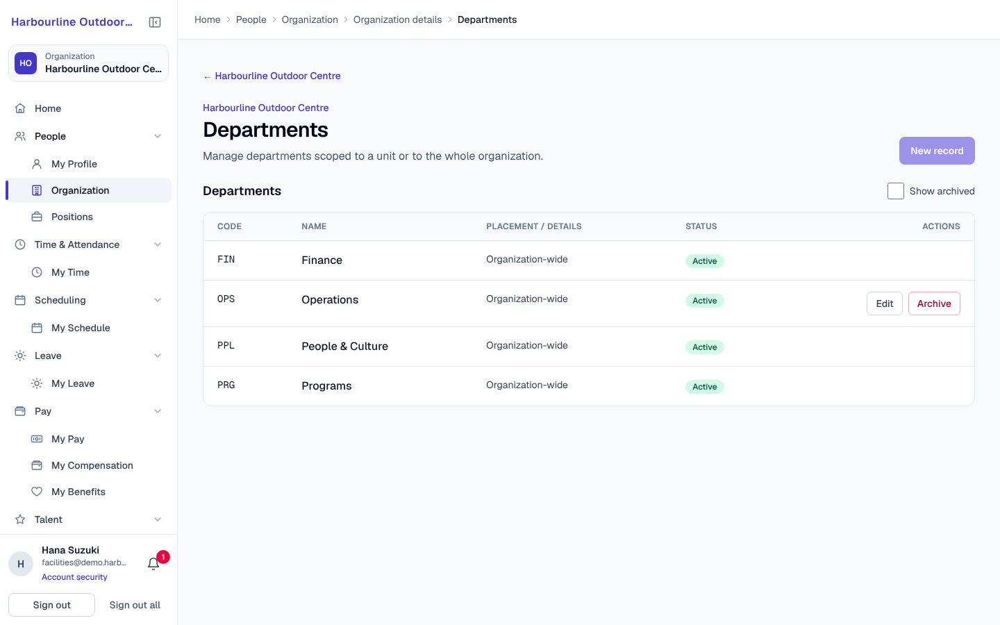

People → Organization → Departments. Hana may read the whole structure, but her
`organization.manage` grant covers only the Operations department. Operations, and the teams and
positions under it, have Edit and Archive actions; Programs, Finance and People & Culture do not.
Creating a team offers only Operations as the parent. Creating a position there offers the
organization's active job titles and work locations: a read-only list (id, name and code) for
anyone who manages part of the organization. Choosing one grants nothing more; job titles and work
locations themselves can be created, edited or archived only with organization-level rights.

**Engineering note:** the API decides: editing or archiving needs `organization.manage` on the
record's own scope, moving also needs it on the destination, and creating needs it on the parent.
The page compares each record's scope and ancestors with the permission snapshot the API reports
for the person and hides the actions those grants don't cover. The API still checks every
request, so a forged one is refused with 403.
